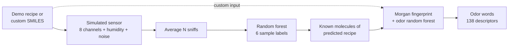

<div align="center">

# 👃 AI Nose

**Pick a smell. A simulated electronic nose sniffs it. A molecule model tells you what it smells like.**


[Quick start](#-quick-start) · [What you can do](#-what-you-can-do) · [How it works](#-how-it-works) · [Real hardware](#-build-a-physical-nose) · [Credits](#-credits)

</div>

---

> [!IMPORTANT]
> The electronic nose here is **software**. Its readings are generated by a simulator and are **not** physical sensor measurements. Accuracy on simulated data says nothing about real-world or hardware accuracy.

An educational, CPU-friendly demo that predicts odor descriptors from molecular structures and pairs them with a simulated eight-channel gas sensor for six sample types. No GPU and no hardware needed.

The odor model is a scikit-learn multilabel classifier trained on Morgan fingerprints and the 4,983-molecule OpenPOM dataset. This project does **not** run OpenPOM's graph neural network.

## 🚀 Quick start

Requires Python 3.10 or newer. From the project root:

```bash
cd smell-ai
python3 -m venv .venv
source .venv/bin/activate          # Windows: .venv\Scripts\activate
pip install -r requirements.txt
python smell_model.py              # 1. train the molecule-to-odor model
python train_nose.py               # 2. train the simulated electronic nose
streamlit run app.py               # 3. open the app in your browser
```

<details>
<summary><b>Notes on setup</b></summary>

- The dataset is bundled, so training needs no download. The first model training may take a few minutes on CPU.
- To check your setup without opening the browser, run `python test_app.py`.
- Already have an environment? Update with `python -m pip install -r requirements.txt`. NumPy 2.x is required for compatibility with the charting dependencies.
- Training scripts print held-out metrics at runtime. Nose accuracy is measured on synthetic readings from the same simulator that produced the training data, so it is **not** evidence of hardware accuracy. The molecule model's score is specific to its dataset split and setup, and can vary with dependency versions.

</details>

## ☁️ Deploy on Streamlit Community Cloud

1. Push this repository to GitHub.
2. In Streamlit Community Cloud, create an app from the repository, select
   branch `main`, and set the main file path to `app.py`.
3. Make sure the repository includes the root `requirements.txt`,
   `samples.json`, and
   `openpom-main/openpom/data/curated_datasets/curated_GS_LF_merged_4983.csv`.
4. Deploy, open the app, and press **Sniff**. If the trained model files are
   absent, the app trains them on the first sniff and shows a notice. The
   molecule model can take a few minutes to train on a cloud CPU.

The generated files under `artifacts/` are intentionally gitignored; do not
commit them just to deploy. Models are cached while the app process is running.
If the service restarts and its local artifacts are unavailable, it will train
them again. If a first-run training attempt fails due to the hosting machine's
resource limits, train a smaller model or use a host with more memory/CPU.

## 🎛️ What you can do

| | |
| --- | --- |
| 🍋 **Sniff a demo smell** | Coffee, vanilla candle, mint, lemon, banana, or wood smoke. |
| 🧪 **Bring your own molecules** | One SMILES per line, optionally `name \| SMILES`. The nose matches them to the closest demo recipe. |
| 🎚️ **Tune the sensor lab** | Sidebar controls for simulated humidity (25–80%), number of noisy sniffs to average, number of odor words, and chart style. |
| 📊 **Read the results** | Sensor readings, all six sample-class probabilities, and odor words. |
| 🔬 **Dig into molecules** | Inspect odor scores for each molecule separately. |
| 💾 **Take it with you** | Download the result as JSON. |

**Try this:** sniff *coffee* with 1 sniff, then again with 20, and watch how averaging steadies the readings. Then raise the humidity and see how the sensor response shifts.

## 🧬 How it works



1. **Molecule input.** Each demo recipe or custom line supplies a SMILES structure.
2. **Simulated sensor.** RDKit derives simple structure properties (molecular weight, oxygen/sulfur content, aromatic rings, polarity, lipophilicity). The simulator combines them into eight normalized channels, adds a humidity effect (25–80%, the training range), then random measurement noise.
3. **Repeat averaging.** The app repeats the sniff with independent noise and averages the channels.
4. **Sample classification.** A random forest maps the eight readings to the six demo labels. For custom molecules this is a match to known categories, not general chemical identification.
5. **Odor description.** RDKit converts each SMILES to a 1,024-bit Morgan fingerprint (radius 2). A multilabel random forest trained on the OpenPOM dataset scores 138 odor descriptors, averaged across the selected molecules.

> [!NOTE]
> The two models do different jobs. The nose consumes simulated sensor values; the odor model consumes known molecular structures. **The sensor never discovers a sample's composition.** For demo recipes, the odor words describe the known ingredients of the predicted recipe. For custom input, they describe the SMILES you entered.

### Files

| File | What it does |
| --- | --- |
| `app.py` | Streamlit interface connecting readings, sample classifier, and odor model. |
| `smell_model.py` | Fingerprints, multilabel random forest training, and odor prediction. |
| `sensor.py` | Simulated eight-channel sensor with humidity effects and noise. |
| `train_nose.py` | Generates 200 noisy sniffs per sample and trains the sample classifier. |
| `samples.json` | Six demo samples and their representative aroma molecules. |
| `test_app.py` | Offline smoke tests for the data, molecules, fingerprints, and readings. |
| `requirements.txt` | Runtime dependencies. |
| `openpom-main/openpom/data/curated_datasets/curated_GS_LF_merged_4983.csv` | Bundled odor dataset. |
| `openpom-main/LICENSE` | MIT notice for the bundled OpenPOM project. |

`openpom-main/requirements.txt` belongs to the upstream neural-network implementation and is not used here. The app only needs the dataset file listed above.

## 🔌 Build a physical nose

<details>
<summary><b>Starting point with a BME688 + ESP32</b></summary>

A BME688 gas sensor can vary its heater temperature to give multiple responses per cycle. A hardware version needs its own data-collection and calibration workflow.

- [ ] Connect the BME688 to an ESP32 over I2C (power, ground, SCL, SDA).
- [ ] Let the sensor stabilize before collecting measurements.
- [ ] Use a BME680-compatible library to read gas resistance at several heater temperatures, for example 200, 250, 300, and 350 °C.
- [ ] Put each smell in its own jar and collect clean-air baselines between samples. Repeat on different days.
- [ ] Normalize each cycle against its clean-air baseline, then train and evaluate on entire held-out sessions.

Avoid hot coffee: steam can dominate the response. Start with distinct smells and test on sessions the classifier never saw. Simulator accuracy does not predict hardware accuracy.

</details>

## 🙏 Credits

<details>
<summary><b>Research, code, and data this project builds on</b></summary>

- **Research behind the Principal Odor Map:** Brian K. Lee, Emily J. Mayhew, Benjamin Sanchez-Lengeling, Jennifer N. Wei, Wesley W. Qian, Kelsie A. Little, Matthew Andres, Britney B. Nguyen, Theresa Moloy, Jane K. Parker, Richard C. Gerkin, Joel D. Mainland, and Alexander B. Wiltschko, “A Principal Odor Map Unifies Diverse Tasks in Human Olfactory Perception,” *Science* 381 (2023), 999–1006. [DOI: 10.1126/science.ade4401](https://doi.org/10.1126/science.ade4401). The work involved researchers from Google Research, Osmo, and the Monell Chemical Senses Center.
- **OpenPOM implementation and dataset curation:** Aryan Amit Barsainyan, Ritesh Kumar, Pinaki Saha, and Michael Schmuker. This project uses the bundled curated dataset from [BioMachineLearning/OpenPOM](https://github.com/BioMachineLearning/openpom), which documents its model as a rebuild of the Principal Odor Map work.
- **Underlying odor data:** OpenPOM's curation materials describe the merged data as drawing from [The Good Scents Company](https://www.thegoodscentscompany.com/) and [Leffingwell PMP 2001](https://zenodo.org/record/4085098). They identify John Leffingwell as an original compiler of odor labels and Sanchez-Lengeling et al. as contributors to cleaning and curation. The [Pyrfume project](https://pyrfume.org/) is referenced by OpenPOM's curation notebooks for accessing the source datasets.

This project uses a scikit-learn fingerprint model and a software sensor simulator. It does not include or reproduce OpenPOM's graph neural network, and the original paper's results are not results of this project.

</details>

## ⚖️ Licensing before publishing

> [!WARNING]
> Check the dataset's source terms before redistributing the CSV or other dataset files.

- The upstream OpenPOM checkout includes its own MIT `LICENSE`; keep that notice if you redistribute material from it.
- OpenPOM's curation notebook describes GoodScents and Leffingwell data with separate use terms. An upstream repository license alone may not settle the rights to underlying third-party data.
- The root `LICENSE` applies the MIT License to this project's own code. It does not automatically grant rights to third-party code or dataset material.

This section is practical guidance, not legal advice or a guarantee of clearance.

## 📚 Further reading

See [OpenPOM](https://github.com/BioMachineLearning/openpom) for the original graph-neural-network implementation and research benchmark. Its published results use a different model and evaluation setup and should not be attributed to this demo.